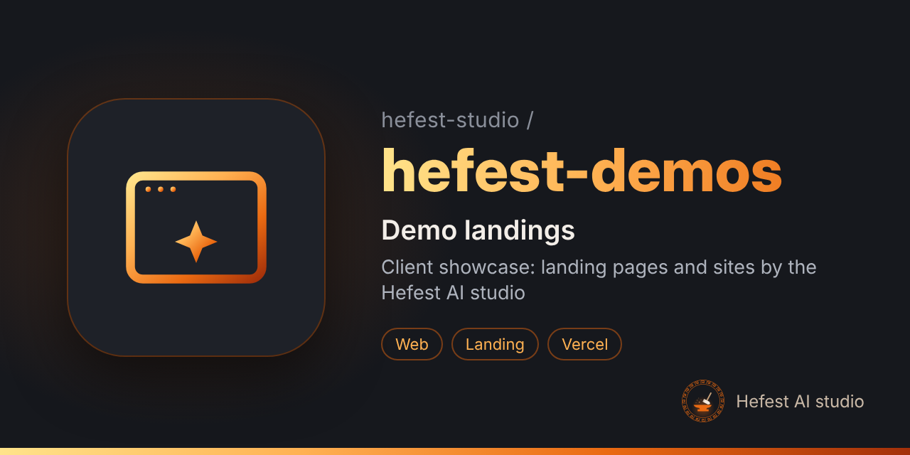

**English** | [Русский](README.ru.md)

# hefest-demos — the Hefest studio demo showcase

Live demo landing pages to show to clients. Hosting — Vercel (auto-deploy from this repository).

- `demos/<slug>/index.html` — one demo; link: `https://<project>.vercel.app/demos/<slug>/`
- The root `index.html` — the showcase (the list of demos is the portfolio).
- What is done and what is next — [roadmap](ROADMAP.md).

Demos are published by the studio on request. The pages are in Russian.
