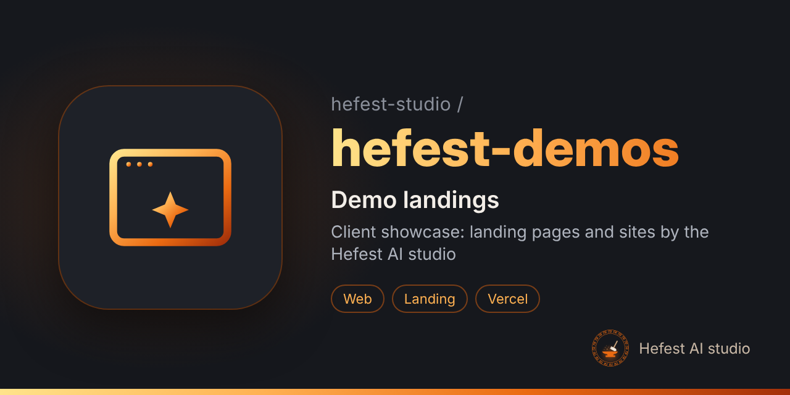

[English](README.md) | **Русский**

# hefest-demos — демо-витрина студии «Гефест»

Живые демо-лендинги для показа заказчикам. Хостинг — Vercel (автодеплой из этого репо).

- `demos/<slug>/index.html` — отдельное демо; ссылка: `https://<project>.vercel.app/demos/<slug>/`
- Корневой `index.html` — витрина (список демо = портфолио).
- Что готово и что дальше — [роадмап](ROADMAP.ru.md).

Публикует директор студии по команде «опубликуй демо». Дизайн — `claude/business/landing-demo-publish-design-2026-11`.
